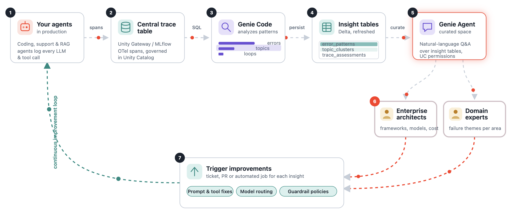

# Agent Trace Analysis: Usage, Errors, and Root Causes

A Databricks notebook-based pipeline that imports agent execution traces in OpenTelemetry format,
analyzes usage patterns, classifies errors with a configurable heuristic taxonomy,
and surfaces root causes of agent failures.

The default dataset is [nvidia/Open-SWE-Traces](https://huggingface.co/datasets/nvidia/Open-SWE-Traces)
(364K SWE-bench trajectories, 55.8M spans, 3 agent frameworks, 3 models), but the notebooks
are parameterized so you can point them at **any** OTel-format trace table — including
Databricks Unity AI Gateway unified traces.



## Repository structure

| Notebook | Purpose |
| --- | --- |
| `01_Import nvidia Open-SWE-Traces from HuggingFace` | Downloads the HuggingFace dataset and writes it as a Delta table. Only needed for the Open-SWE-Traces dataset. |
| `02_Transform to OTel Spans` | Converts the raw dataset into an OTel span table matching the Unity Gateway / MLflow trace schema. Skip this if your data is already in OTel format. |
| `03_Usage and Error Analysis` | **Main analysis notebook.** Trajectory-level metrics, resolve rates, tool usage, error taxonomy, root cause analysis. All heuristics are defined in editable cells at the top. |
| `04_LLM Resolve Classifier Experiment` | (Optional) Uses `ai_classify` and a custom LLM judge via `ai_query` to predict whether agent trajectories resolved their issues, evaluated against ground-truth labels. |
| `05_create_genie_error_agent.py` | Creates a Genie Agent (AI/BI data room) pre-configured for error analysis: surfaces the most frequent errors and recommends what to fix next. |

## Prerequisites

- A Databricks workspace with Unity Catalog enabled
- A serverless SQL warehouse (auto-selected when running notebooks on serverless compute)
- A catalog and schema where you can create tables (default: `main.nvidia_open_swe_traces` — change this in each notebook's Configuration cell)

## Reproduction steps

### 1. Import the dataset (one-time)

Open **01_Import nvidia Open-SWE-Traces from HuggingFace** and edit the Configuration cell:

```sql
CREATE WIDGET TEXT target_schema DEFAULT 'your_catalog.your_schema';
CREATE WIDGET TEXT traces_table DEFAULT 'your_catalog.your_schema.traces';
```

Run all cells. This downloads the dataset from HuggingFace (\~40 GB) and writes it as a Delta table.

### 2. Transform to OTel spans

Open **02_Transform to OTel Spans** and set the Configuration widgets:

```sql
CREATE WIDGET TEXT traces_table DEFAULT 'your_catalog.your_schema.traces';
CREATE WIDGET TEXT otel_spans_table DEFAULT 'your_catalog.your_schema.otel_spans';
CREATE WIDGET TEXT sample_modulus DEFAULT '1000';  -- 1000 = ~350 traces (fast); 1 = all 364K (full load)
```

Run all cells. Set `sample_modulus` to `1` for a full load (\~56M spans, \~9 min on serverless SQL).

### 3. Run the analysis

Open **03_Usage and Error Analysis** and set the Configuration widgets:

```sql
CREATE WIDGET TEXT otel_spans_table DEFAULT 'your_catalog.your_schema.otel_spans';
CREATE WIDGET TEXT output_schema DEFAULT 'your_catalog.your_schema';
```

Review the **Error heuristics** cell — this is where you customize the error classification
patterns for your agent framework. Then run all cells top-to-bottom.

The last cell (**Persist summary tables for the Genie error agent**) writes three tables to
`output_schema`: `classified_errors`, `trajectory_summary` and `error_taxonomy_summary`.
These are required for step 5.

### 4. (Optional) LLM resolve classifier

Open **04_LLM Resolve Classifier Experiment**, set the `traces_table` widget and choose an
LLM endpoint. This notebook uses `ai_classify` and `ai_query` (which incur LLM inference costs).

Runs are logged to the MLflow experiment `/Users/<you>/swe_resolve_llm_classifier`
(`MLFLOW_EXPERIMENT` in the *Choose LLM endpoint* cell). The final threshold-tuning cell reuses
the judge run from the same session; to tune an earlier run, set `SOURCE_RUN_ID` to its run ID.

### 5. (Optional) Create the Genie Error Analyzer agent

The `05_create_genie_error_agent.py` script creates a Genie space pre-configured to surface
the most frequent errors in agent trajectories and recommend which to fix next.
It requires the summary tables written by the last cell of notebook 03 (step 3).

It uses the `POST /api/2.0/genie/spaces` REST API and includes:

- **3 tables:** `classified_errors`, `trajectory_summary`, `error_taxonomy_summary` (created by notebook 03)
- **Text instructions:** domain context, ungraded-exclusion rules, prioritization guidance
- **8 starter questions** covering error frequency, framework comparison, and fix prioritization
- **3 curated SQL examples** the agent can reference for common analyses
- **SQL snippets and measures** for reusable filters (`exclude ungraded`, `actionable errors only`)
  and metrics (`resolve rate`, `avg errors per trajectory`)
- **Join specs** linking `classified_errors` to `trajectory_summary` on `trace_id`

**From a Databricks notebook:**

```python
%run ./05_create_genie_error_agent

result = create_genie_space(
    catalog="your_catalog",
    schema="your_schema",
    # parent_path defaults to /Workspace/Users/<you>/AgentTraces
)
print(f"Space URL: /genie/rooms/{result['space_id']}")
```

**From the command line** (with Databricks CLI authentication configured):

```bash
python 05_create_genie_error_agent.py \
    --catalog your_catalog \
    --schema your_schema \
    --parent-path /Workspace/Users/you@example.com/AgentTraces   # optional
```

The defaults point to `main.nvidia_open_swe_traces`, and the space is created in
`/Workspace/Users/<you>/AgentTraces`.
Edit the `DEFAULT_*` constants at the top of the script to change them permanently.
The Genie space can also be created interactively from the Databricks UI — the script
simply automates the same configuration.

Once created, open the Genie space in the UI and try a starter question like
*"What are the top 5 errors I should fix first to improve resolve rates the most?"*

## Adapting for Unity AI Gateway traces

If your agent traces are already captured by Databricks Unity AI Gateway or MLflow tracing,
you can **skip steps 1 and 2** and point the analysis notebook directly at your trace table.

### Point to your trace table

In the analysis notebook's Configuration cell, set `otel_spans_table` to your table:

```sql
-- Unity AI Gateway unified trace table:
CREATE WIDGET TEXT otel_spans_table DEFAULT 'system.ai_gateway.unity_gateway_otel_spans';

-- Or a per-endpoint inference table:
CREATE WIDGET TEXT otel_spans_table DEFAULT 'my_catalog.my_schema.my_endpoint_otel_spans';
```

### Adapt the trajectory view

The `trajectories` temp view in cell 4 extracts SWE-bench-specific attributes (`swe.resolved`,
`swe.repo`, `swe.language`, etc.). For Gateway traces, replace these with the attributes
your agent emits. The standard OTel/MLflow attributes that work unchanged include:

- `gen_ai.request.model` — the model used
- `gen_ai.usage.input_tokens` / `gen_ai.usage.output_tokens` — token counts
- `mlflow.spanType` — span type (AGENT, CHAT_MODEL, TOOL)
- `status.code` / `status.message` — error status

### Adapt the error heuristics

The **Error heuristics** cell contains `LIKE` patterns tailored to SWE-bench agent errors
(missing `javac`, `CTRL+C` timeouts, `str_replace_editor` mismatches). Replace these with
patterns that match your agent's error signatures, e.g.:

```sql
WHEN status.message LIKE '%rate_limit_exceeded%' THEN 'rate limit'
WHEN status.message LIKE '%context_length_exceeded%' THEN 'context overflow'
WHEN status.message LIKE '%connection refused%' THEN 'tool: service unavailable'
```

## Data size and cost

> **Warning:** The full Open-SWE-Traces dataset is large.
>
> - **Raw dataset download:** \~40 GB from HuggingFace
> - **Delta table (traces):** \~40 GB compressed
> - **OTel span table:** \~55.8 million rows (\~364K traces), \~30 GB compressed
> - **Transform time:** \~9 minutes on a serverless SQL warehouse for the full dataset
> - **Analysis queries:** Each query scans the full OTel span table. On a serverless SQL
>   warehouse, expect \~$1-5 in DBU cost for a complete run of the analysis notebook.
>
> **To reduce cost during development:** Set `sample_modulus` to `1000` in the transform
> notebook to load only \~350 traces (\~0.1% sample). This runs in seconds and is sufficient
> to validate the pipeline before a full load.
>
> **For Unity AI Gateway traces:** Your table size depends on your traffic. The analysis
> queries scale linearly with table size. Consider adding time filters
> (`WHERE date >= current_date() - 7`) to limit scan scope on large tables.

## Limitations of the error classifier

The error taxonomy in the analysis notebook is a **heuristic, pattern-based classifier** —
it matches `LIKE` patterns against `status.message` to assign each error span to a category.
This approach has known limitations:

- **Order-dependent:** Patterns are evaluated top-to-bottom; the first match wins. Reordering
  rules can change the classification of ambiguous errors.
- **Dataset-specific:** The default patterns are tailored to SWE-bench agent outputs
  (bash tool errors, `str_replace_editor`, Go test invocations). They will miss or
  misclassify errors from agents with different tool sets.
- **Incomplete coverage:** The catch-all bucket (`other non-zero exit`) is typically the
  largest category (\~68% of errors in the SWE-bench data). Many of these are normal
  exploration noise (e.g., a `grep` with no match), but some may hide real issues.
- **No semantic understanding:** Pattern matching cannot distinguish between a test failure
  caused by a genuine bug and one caused by a flaky test or environment issue.

### Why a simple classifier is often sufficient in practice

Despite these limitations, **pattern-based classification is often the right starting point**
for diagnosing agent failures at scale:

1. **Dominant failure modes are obvious.** In the SWE-bench data, the top actionable error
   categories — environment failures (missing toolchains, missing dependencies), timeouts,
   and edit mismatches — account for the bulk of fixable issues. A handful of `LIKE` patterns
   surface them reliably.

2. **Error count barely predicts outcome.** The analysis shows that error rates are similar
   between resolved and unresolved trajectories (3.5 vs 4.1 avg errors for minisweagent).
   Most tool errors are normal exploration noise, not root causes. You don't need a
   sophisticated classifier to reach this conclusion — simple counting suffices.

3. **The real value is in the taxonomy, not precision.** The goal is not to classify every
   error perfectly, but to answer: *What are the main categories of failures in my agent
   stack, and which ones are actionable?* A 10-rule heuristic that gets 80% of the
   classification right answers this question well enough to prioritize engineering work.

4. **LLM classifiers add cost without proportional value for this task.** The LLM Resolve
   Classifier experiment in this repo shows that even a capable LLM judge (Claude Opus)
   achieves only \~70% accuracy predicting resolve outcomes from issue+patch alone. The
   heuristic error taxonomy, despite its simplicity, is more directly actionable: it tells
   you *what went wrong* (missing toolchain, timeout, bad edit), not just *whether it
   worked*.

For production monitoring, start with the heuristic classifier and iterate: add patterns
as you discover new failure modes in your agent stack. Graduate to an LLM-based classifier
only when you need semantic understanding of error context (e.g., distinguishing "test
failed because the fix is wrong" from "test failed because of a flaky environment").

## License

The analysis code in this repository is provided as-is for reference and reproduction.
The [nvidia/Open-SWE-Traces](https://huggingface.co/datasets/nvidia/Open-SWE-Traces)
dataset is subject to its own license terms on HuggingFace.
